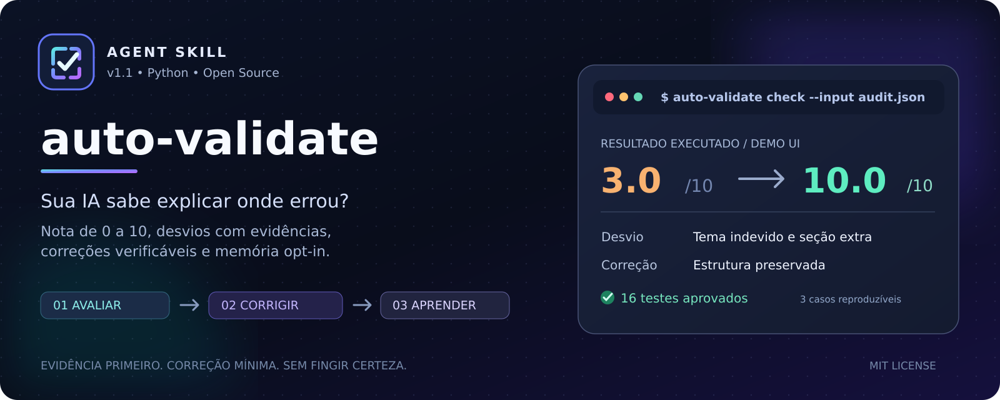

<p align="center">
  
</p>

<p align="center">
  <a href=".github/workflows/ci.yml"></a>
  <a href="https://agentskills.io/specification"></a>
  <a href="LICENSE"></a>
  <a href="https://www.python.org/"></a>
</p>

<h1 align="center">Auto-Validate</h1>
<p align="center"><strong>Avalie a entrega. Faça a IA explicar onde errou. Corrija o desvio. Valide novamente.</strong></p>

**Auto-Validate** é uma skill aberta para agentes de IA que implementa um ciclo de qualidade orientado ao **prompt original**: avaliação de **0 a 10**, evidências por requisito, diagnóstico de falhas, correção mínima, revalidação e **memória persistente somente com autorização**.

> Uma boa resposta não é apenas convincente: ela precisa respeitar o que foi solicitado.

## Demonstração: código e resultados executados

Estes **três cenários de uso prático** estão inteiramente versionados no repositório. As entregas *antes* realmente contêm os desvios descritos; as versões *depois* trazem correções; os **16 testes** inspecionam o código e os arquivos. O motor da skill foi executado para gerar os relatórios abaixo.

| Caso | Solicitação | Erro encontrado | Nota antes | Nota após correção | Evidência |
|---|---|---|---:|---:|---|
| Interface UI | Preservar white mode, hero, features e CTA | Tema escuro e seção adicional | **3,0/10** | **10,0/10** | [Antes](examples/results/ui-before.md) · [Depois](examples/results/ui-after.md) |
| Código Python | Ordenar preços como números | Ordenação lexicográfica de strings | **6,0/10** | **10,0/10** | [Antes](examples/results/code-before.md) · [Depois](examples/results/code-after.md) |
| Texto técnico | Não prometer capacidades inexistentes | Afirmação de “100%” e memória automática | **3,0/10** | **10,0/10** | [Antes](examples/results/text-before.md) · [Depois](examples/results/text-after.md) |

**Os resultados acima são de cenários controlados e reproduzíveis, não uma avaliação estatística em produção.** As cinco notas por critério são atribuídas por um avaliador com base nas evidências; o script valida o formato, aplica pesos e limites e gera o relatório. Ele **não determina sozinho a qualidade semântica**, nem simula o uso real por um modelo.

### Execute os três casos no seu computador

```bash
python examples/run_demos.py
python -m unittest discover -s tests -v
python examples/demo_memory.py    # gravação temporária isolada, opt-in de demonstração
```

Saída obtida nesta versão:

```text
ui      3.0/10 -> 10.0/10 (relatórios: examples/results/)
code    6.0/10 -> 10.0/10 (relatórios: examples/results/)
text    3.0/10 -> 10.0/10 (relatórios: examples/results/)
Nenhuma memória foi gravada: demonstração sem --save-memory.

Ran 16 tests
OK
```

Para ver o que a skill identificou e como foi corrigido, abra **[Casos de uso com comparações e comandos](docs/CASOS_DE_USO.md)**.

## O que a skill faz

```text
PROMPT ORIGINAL                         ENTREGA DA IA
        └──────────────┬─────────────────────┘
                       ▼
              EXTRAIR REQUISITOS
                       ▼
            INSPECIONAR EVIDÊNCIAS
                       ▼
             AVALIAR 0 A 10
                       ▼
       DECLARAR ONDE A IA DIVERGIU
                       ▼
           PLANO DE CORREÇÃO
                       ▼
         CORRIGIR (SE AUTORIZADO)
                       ▼
          REVALIDAR A ENTREGA
                       ▼
       PROPOR MEMÓRIA PREVENTIVA
                       ▼
      PERSISTIR SOMENTE COM OPT-IN
```

- **Autodiagnóstico explicável:** separa solicitado, observado, evidência e correção; causas internas são hipóteses, não fatos conhecidos.
- **Fidelidade ao contexto:** identifica alterações não autorizadas e informações sem lastro, inclusive instruções antigas que tenham sido ignoradas.
- **Menos alucinações identificáveis:** orienta o agente a marcar lacunas como `unverifiable` em vez de inventar conclusões; **não elimina alucinações**.
- **Menos retrabalho:** foca nas diferenças e preserva partes corretas da entrega.
- **Aprendizado reaproveitável:** propõe regras de prevenção; com autorização, grava JSONL em armazenamento persistente real.

## Instalação

Requisitos: **Python 3.10+** para o script local e um agente que reconheça o padrão [Agent Skills](https://agentskills.io/specification) para o fluxo completo. Sem bibliotecas Python extras ou chaves de API.

```bash
# Clone este repositório após publicá-lo no GitHub:
git clone https://github.com/lenixeduardo/auto-validate.git
cd auto-validate

# Instala a skill no seu projeto:
python install.py /caminho/para/meu-projeto

# Alternativa em .github/skills/ para configurações específicas do Copilot:
python install.py /caminho/para/meu-projeto --target github
```

Para ambientes sem repositório publicado, copie o diretório `.agents/skills/auto-validate/` para o projeto. A instalação **não** cria uma conta, não configura um LLM e não dá acesso automático ao histórico de outras sessões.

## Invocação no seu agente

```text
/auto-validate
Compare o meu pedido original com esta entrega.
Avalie de 0 a 10 com evidências por requisito.
Informe onde errou, a correção mínima e como irá testá-la.
Corrija apenas o que foi autorizado e faça uma segunda avaliação.
Não registre memória persistente sem minha autorização explícita.
```

> `/auto-validate` é uma sugestão de invocação: depende do ambiente e de como ele descobre e expõe skills. Na ausência desse comando, peça em linguagem natural para **usar a skill `auto-validate`**.

### CLI para auditar um JSON estruturado

```bash
python .agents/skills/auto-validate/scripts/auto_validate.py check \
  --input examples/cases/code/audit-before.json \
  --output /tmp/relatorio.md \
  --json-out /tmp/nota.json
```

**Atenção:** o agente (ou revisor) constrói o JSON de avaliação a partir da inspeção real da entrega. O CLI apenas verifica e processa essa avaliação; ele não acessa LLMs e não modifica arquivos automaticamente.

## Como a nota é calculada

| Dimensão | Peso |
|---|---:|
| Fidelidade ao pedido | 35% |
| Completude | 25% |
| Precisão e evidências | 20% |
| Respeito às restrições | 15% |
| Utilidade | 5% |

Descumprimentos de requisitos obrigatórios, restrições expressas e falhas críticas impõem **limites à nota**, mesmo que a média ponderada seja alta. A pontuação é uma **heurística auditável**, não uma métrica científica. Consulte [a rubrica](.agents/skills/auto-validate/references/scoring.md).

## Memória persistente, com controle do usuário

A skill **propõe** regras para evitar erros recorrentes. Ela **não as grava automaticamente**. Somente após autorizar a persistência e revisar os dados:

```bash
python .agents/skills/auto-validate/scripts/auto_validate.py check \
  --input examples/cases/ui/audit-before.json \
  --save-memory \
  --memory-path ./state/minhas-regras.jsonl

python .agents/skills/auto-validate/scripts/auto_validate.py memory search \
  --path ./state/minhas-regras.jsonl \
  --project demo-ui \
  --query "seções além solicitadas"
```

Para uma demonstração isolada do ciclo de escrita e recuperação (sem salvar sua memória pessoal), rode `python examples/demo_memory.py`. O script usa armazenamento temporário e o descarta ao terminar.

O diretório `state/` é ignorado pelo Git. O agente precisa **carregar** a memória nas sessões futuras para utilizá-la. Evite salvar segredos, credenciais e dados pessoais. Há comandos `memory list` e `memory remove` para inspeção e exclusão.

## Estrutura do projeto

```text
auto-validate/
├── assets/                       # capa editável (SVG) e PNG
├── .agents/skills/auto-validate/  # SKILL.md, referências, script e template
├── .github/workflows/ci.yml      # testes no GitHub Actions
├── docs/                         # casos de uso e texto de apresentação
├── examples/
│   ├── cases/                    # entradas reais: UI, código e texto
│   ├── results/                  # relatórios gerados pelo motor da skill
│   ├── run_demos.py              # demonstrações reproduzíveis
│   └── demo_memory.py            # escrita e recuperação isoladas
├── tests/                         # testes do motor + regressão dos casos
├── install.py                     # instalador portátil
├── publish-github.sh / .ps1       # publicação via GitHub CLI, sob demanda
├── LICENSE
└── README.md
```

## Publicar no GitHub

Esta distribuição inclui o repositório completo e um commit Git local. A publicação exige autenticação na sua conta GitHub; os scripts **não são executados automaticamente**. Após extrair o ZIP:

```powershell
gh auth login
.\publish-github.ps1
```

Em macOS/Linux/Git Bash, use `bash publish-github.sh`. Ambos criam `lenixeduardo/auto-validate`, enviam os arquivos e configuram About e topics. O social preview (`assets/cover.png`) precisa ser enviado manualmente em **Settings → General → Social preview**.

## Limitações e segurança

A autoavaliação de um modelo pode falhar. A skill não descobre automaticamente todas as alucinações, não acessa raciocínio privado do modelo, não corrige código sem permissão e não garante memória entre sessões. O script local aplica uma rubrica a evidências estruturadas; **testes independentes, revisão humana e validação em ambiente real continuam necessários**.

Veja também [About / posicionamento](docs/ABOUT.md) · [Contribuição](CONTRIBUTING.md) · [Segurança](SECURITY.md) · [Licença MIT](LICENSE).
